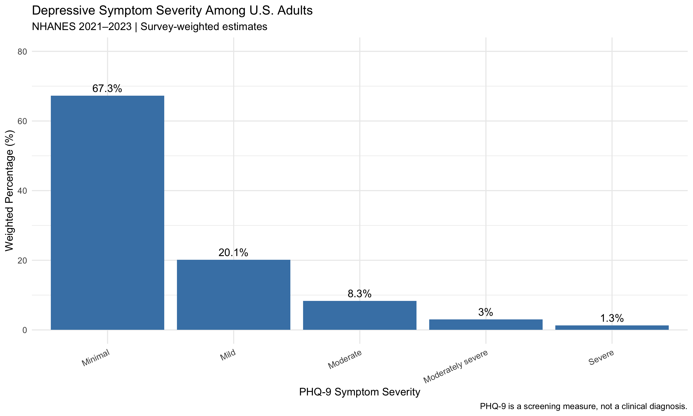
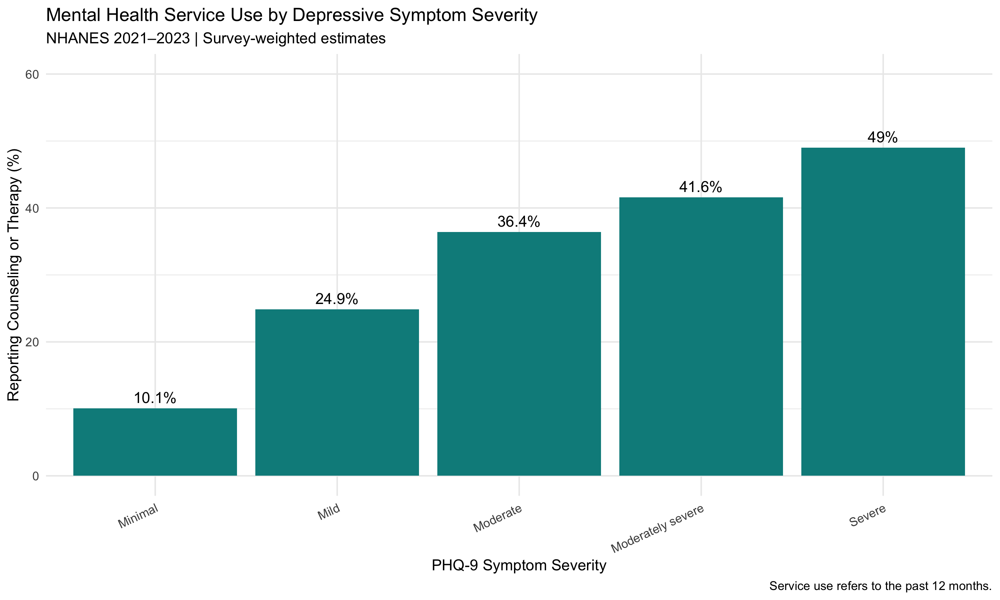
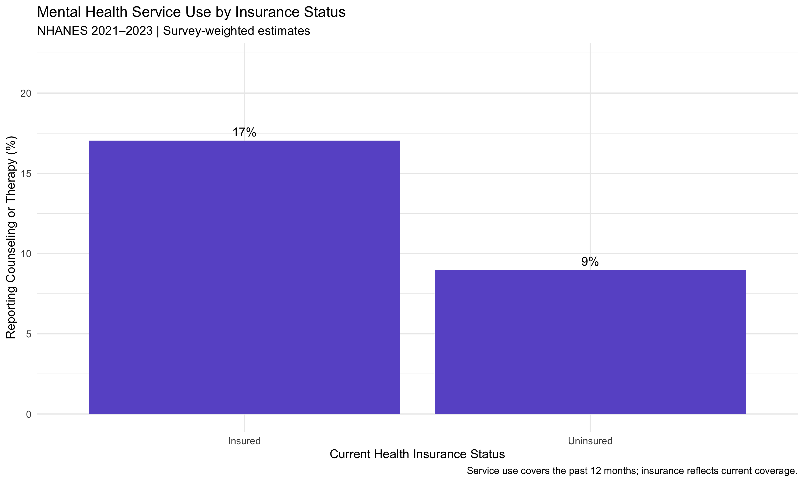

# Introduction

Access to mental health services is an important component of healthcare access. Individuals experiencing depressive symptoms may have different patterns of mental health service use depending on their health insurance coverage and access to a usual source of care.

This project examines the relationship between depressive symptom severity, health insurance status, usual source of healthcare, and mental health service use among U.S. adults.

# Research Questions

1. How does mental health service use vary by depressive symptom severity?
2. Does mental health service use differ by health insurance status?
3. Is having a usual source of healthcare associated with mental health service use?

# Data and Methods

## Data Source

This analysis uses publicly available data from the National Health and Nutrition Examination Survey (NHANES) 2021–2023. The analytic population consists of adults aged 18 and older who participated in the Mobile Examination Center component.

## Measures

Depressive symptoms were measured using the nine-item Patient Health Questionnaire (PHQ-9). Scores range from 0 to 27 and were grouped into five severity categories.

Mental health service use was based on self-reported counseling or therapy during the previous 12 months. Health insurance status and usual source of care were also examined.

## Statistical Analysis

Survey-weighted descriptive statistics accounted for NHANES sampling weights, strata, and primary sampling units. Survey-weighted logistic regression was used to estimate adjusted associations between depressive symptom severity, insurance status, usual source of care, and mental health service use.

The adjusted regression analysis included 5,430 participants with complete data.

# Results

## Depressive Symptom Severity

```{r}
#| echo: false

```
Survey-weighted estimates indicated that approximately 67.3% of U.S. adults were in the Minimal PHQ-9 symptom category. Approximately 20.1% were in the Mild category, 8.3% in the Moderate category, 3.0% in the Moderately severe category, and 1.3% in the Severe category.

Overall, approximately 32.7% of adults reported at least mild depressive symptoms based on their PHQ-9 scores.

## Mental Health Service Use by Depressive Symptom Severity
```{r}
#| echo: false

```
Mental health service use increased with depressive symptom severity. Approximately 10.1% of adults in the Minimal symptom category reported mental health counseling or therapy during the previous 12 months, compared with 49.0% of adults in the Severe category.

## Mental Health Service Use by Insurance Status

```{r}
#| echo: false

```
Survey-weighted estimates indicated that approximately 17.0% of insured adults reported mental health counseling or therapy during the previous 12 months, compared with approximately 9.0% of uninsured adults. This suggests that insurance status may be associated with access to mental health services.

## Adjusted Regression Findings

In the survey-weighted logistic regression model (n = 5,430), depressive symptom severity was associated with higher odds of mental health service use.

Compared with adults in the Minimal symptom category:

- Adults with Mild symptoms had 2.99 times the adjusted odds of service use.
- Adults with Moderate symptoms had 5.18 times the adjusted odds.
- Adults with Moderately severe symptoms had 6.97 times the adjusted odds.
- Adults with Severe symptoms had 9.22 times the adjusted odds.

Uninsured adults had approximately 46% lower adjusted odds of service use than insured adults. Adults without a usual source of care had approximately 42% lower adjusted odds than adults with a usual source of care.

These findings represent adjusted associations and should not be interpreted as causal effects.

## Full Regression Results

The following table presents adjusted odds ratios, 95% confidence intervals, and p-values from the survey-weighted logistic regression model.

```{r}
#| echo: false

regression_results <- read.csv(
  "outputs/tables/adjusted_logistic_regression_binary_care.csv"
)

names(regression_results) <- c(
  "Predictor",
  "Adjusted Odds Ratio",
  "95% CI Lower",
  "95% CI Upper",
  "P-value"
)

knitr::kable(
  regression_results,
  digits = 3,
  caption = "Survey-Weighted Logistic Regression Results",
  align = c("l", "c", "c", "c", "c")
)
```

# Limitations

- The cross-sectional design does not establish cause and effect.
- Measures of service use and insurance were self-reported.
- Current insurance status and service use over the previous 12 months have different reference periods.
- The PHQ-9 is a screening measure, not a clinical diagnosis.
- The adjusted analysis excluded participants with missing data.

# Conclusion

This project examines how depressive symptom severity and healthcare access factors are associated with mental health service use among U.S. adults. Findings should be interpreted as associations rather than causal effects.

# References

National Center for Health Statistics. National Health and Nutrition Examination Survey (NHANES), 2021–2023. Centers for Disease Control and Prevention.

https://wwwn.cdc.gov/nchs/nhanes/search/datapage.aspx?Cycle=2021-2023

